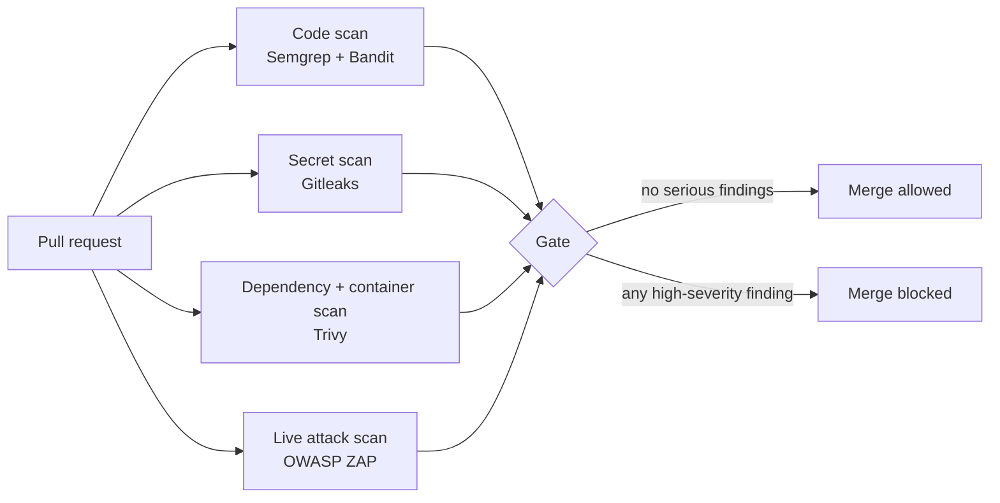

# DevSecOps Pipeline

[](https://github.com/funsoi-hub/devsecops-pipeline/actions/workflows/self-test.yml)
[](https://github.com/funsoi-hub/devsecops-pipeline/actions/workflows/lint-workflows.yml)

A security gate for GitHub that checks every pull request for vulnerabilities and **refuses to let risky code reach the main branch.** Any repository can plug it in with about 10 lines of configuration.

It currently protects my [Secure Vault](https://github.com/funsoi-hub/secure-vault) app.

## Why I built this

Running security scans by hand is something I do a lot, and the problem is always the same: by the time a report is written, the vulnerable code is already live. I wanted the checks to happen **automatically, before the code is merged**, so a problem gets fixed while it's still cheap to fix.

I also wanted it to be reusable. Instead of copy-pasting scanner setup into every project, I fix a rule once here and every repo that uses the gate gets the improvement.

## How it works



All four scans run side by side. A final "gate" step adds up the results and fails the build if anything serious turned up.

## What each scan looks for

| Scan | Tool | What it catches | Blocks on |
|---|---|---|---|
| **Code (SAST)** | Semgrep + Bandit | SQL injection, command injection, unsafe deserialisation, weak crypto, debug mode left on | High severity |
| **Secrets** | Gitleaks | API keys, tokens and passwords committed to git, **even ones deleted in later commits** | Any secret |
| **Dependencies** | Trivy | Known vulnerabilities (CVEs) in the libraries a project uses | High or critical, where a fix exists |
| **Container image** | Trivy | Known vulnerabilities in the Docker image's operating system and packages | High or critical, where a fix exists |
| **Dockerfile** | Trivy | Risky container setup, like running as root | High or critical |
| **Running app (DAST)** | OWASP ZAP | Missing security headers, insecure cookies, information leaks, found by poking the live app | High risk |

Every finding shows up as a note on the pull request, and the run summary lists them in a table, so nobody has to dig through log files.

## Proof that it actually works

A gate that always passes proves nothing, so I built a test for the gate itself.

[`examples/vulnerable-app`](examples/vulnerable-app) is a tiny web app I wrote **deliberately full of holes**, one for each scanner: SQL injection, command injection, unsafe YAML parsing, debug mode, a committed API key, outdated libraries, an end-of-life base image and a container running as root.

On every change, the [self-test](.github/workflows/self-test.yml) runs the gate against that app and **fails if the gate doesn't catch the problems.** If a scanner ever silently breaks, I find out straight away.

It's already proved itself on a real project: on its first run against Secure Vault, it blocked the build over 5 high-severity vulnerabilities hidden in the Docker base image.

## Securing the pipeline itself

A security pipeline is an attractive target: it runs on every commit and often has access to secrets. In March 2026 attackers [hijacked the popular trivy-action](https://github.com/aquasecurity/trivy/security/advisories/GHSA-69fq-xp46-6x23), and anyone who referenced it by version tag ran their credential-stealing code. With that in mind, I:

- **Pin every GitHub Action to an exact commit**, not a version tag that can be quietly moved.
- **Don't use third-party scanner actions at all.** I download Trivy and Gitleaks myself and check each download against a known fingerprint (SHA-256 checksum) before running it.
- **Give the pipeline read-only access**, and don't leave login credentials on the runner.
- **Never paste untrusted values straight into shell commands**, which prevents a class of attack called template injection.
- **Scan my own workflow files** with [zizmor](https://docs.zizmor.sh), a security linter for GitHub Actions, on every change.

## Use it in your own repo

Add this file to your repository as `.github/workflows/security.yml`:

```yaml
name: security
on:
  pull_request:
  push:
    branches: [main]
permissions:
  contents: read
jobs:
  security:
    uses: funsoi-hub/devsecops-pipeline/.github/workflows/security-gate.yml@<commit-sha>
    permissions:
      contents: read
      security-events: write
    with:
      source-dir: app          # where your code lives
      dockerfile: Dockerfile   # leave out to skip the container and live scans
      run-dast: true
      app-port: 8000
      healthcheck-path: /healthz
      pipeline-ref: <same-commit-sha>
```

Then make it mandatory. In your repo, go to **Settings → Rules → Rulesets → New branch ruleset**, target `main`, turn on **Require status checks to pass**, and add `security / gate`.

<details>
<summary>All options</summary>

| Option | Default | What it's for |
|---|---|---|
| `source-dir` | `.` | The code to scan |
| `project-dir` | `.` | Folder with your requirements files and Docker build |
| `dockerfile` | _(empty)_ | Path to your Dockerfile; leave empty to skip the container and live scans |
| `run-dast` | `false` | Start your app and attack it with OWASP ZAP |
| `app-port` / `healthcheck-path` / `dast-path` | `8000` / `/` / `/` | How to reach your app during the live scan |
| `container-env` | _(empty)_ | `KEY=VALUE` settings for the app during the scan (no real secrets) |
| `enforce` | `true` | Set to `false` to report findings without blocking |
| `pipeline-ref` | `main` | Set to the same commit as the `uses:` line |

The gate also outputs `high-findings`, the total number of serious findings.

</details>

## Decisions I made, and why

- **Only block on serious, fixable issues.** If a gate blocks on every minor warning, people learn to ignore it. Vulnerabilities with no fix yet are reported but don't block, because nobody can act on them.
- **Scan the whole git history for secrets.** Deleting a leaked key in a later commit doesn't un-leak it. It has to be revoked and replaced.
- **Run each scanner separately.** If one breaks, the others still report, and one problem never hides another.

## What I learned

- **Tools are the easy part; tuning them is the job.** Picking severity thresholds that catch real problems without drowning people in noise took more thought than wiring up the scanners.
- **Your CI pipeline is part of your attack surface.** The trivy-action incident changed how I think about "trusted" tools.
- **Test your security controls, not just your code.** The deliberately vulnerable app is what gives me confidence the gate works.

---

Built by **Funso Isola** · [LinkedIn](https://linkedin.com/in/funisola) · [More projects](https://github.com/funsoi-hub)
