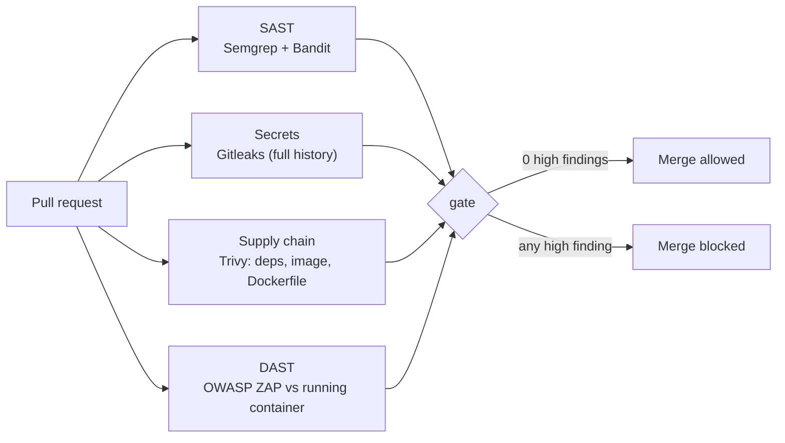

# DevSecOps Pipeline: a reusable CI security gate

[](https://github.com/funsoi-hub/devsecops-pipeline/actions/workflows/self-test.yml)
[](https://github.com/funsoi-hub/devsecops-pipeline/actions/workflows/lint-workflows.yml)

A reusable GitHub Actions workflow that runs five kinds of security testing on every pull request and **fails the build on any high-severity finding**. Make its check required, and risky code can't reach `main`.

It protects [Secure Vault](https://github.com/funsoi-hub/secure-vault), and any repo can use it with about 10 lines of YAML.



## What each stage catches

| Stage | Tool | Catches | Fails on |
|---|---|---|---|
| SAST | Semgrep (`p/python`, `p/owasp-top-ten`) + Bandit | Injection, unsafe deserialisation, shell commands, weak crypto, debug mode | Semgrep `ERROR`, Bandit `HIGH` (medium+ confidence) |
| Secrets | Gitleaks | API keys, tokens and passwords, **including ones deleted in later commits** | Any finding |
| Dependencies (SCA) | Trivy `fs` | Known CVEs in `requirements.txt`, lock files and so on | `HIGH`/`CRITICAL` with a fix available |
| Container image | Trivy `image` | CVEs in the OS packages and libraries of the built image | `HIGH`/`CRITICAL` with a fix available |
| Dockerfile (IaC) | Trivy `config` | Running as root, unpinned base images, secrets in layers | `HIGH`/`CRITICAL` |
| DAST | OWASP ZAP baseline | Missing headers, cookie flags, information leaks in the **running** app | ZAP risk `High` |

Each finding appears as an annotation on the run and pull request, and the job summary lists them in a table. Semgrep findings also go to the repo's **Security → Code scanning** tab, and full reports are kept as downloadable artifacts.

## Use it in your repo

```yaml
# .github/workflows/security.yml
name: security
on:
  pull_request:
  push:
    branches: [main]
permissions:
  contents: read
jobs:
  security:
    uses: funsoi-hub/devsecops-pipeline/.github/workflows/security-gate.yml@<commit-sha>  # v1
    permissions:
      contents: read
      security-events: write
    with:
      source-dir: app          # code to scan
      dockerfile: Dockerfile   # omit to skip image scan + DAST
      run-dast: true
      app-port: 8000
      healthcheck-path: /healthz
      pipeline-ref: <same-commit-sha>
```

Then **block merging when it fails**: in the repo, go to Settings → Rules → Rulesets → New branch ruleset. Target `main`, turn on **Require status checks to pass**, and add `security / gate`.

| Input | Default | Purpose |
|---|---|---|
| `source-dir` | `.` | Code to scan with SAST |
| `project-dir` | `.` | Folder with requirements files and the Docker build context |
| `dockerfile` | _(empty)_ | Dockerfile path relative to `project-dir`; empty skips image scan and DAST |
| `run-dast` | `false` | Start the container and scan it with ZAP |
| `app-port` / `healthcheck-path` / `dast-path` | `8000` / `/` / `/` | How to reach the app during DAST |
| `container-env` | _(empty)_ | `KEY=VALUE` lines for the DAST container (no real secrets) |
| `enforce` | `true` | `false` reports findings without failing |
| `pipeline-ref` | `main` | Ref to load helper scripts from; set it to the same commit SHA as the `uses:` line |

Output: `high-findings`, the total count across all stages.

## Proof that it works

A gate that always passes proves nothing. [`examples/vulnerable-app`](examples/vulnerable-app) is a small Flask app with one planted flaw for each scanner (SQL injection, `shell=True`, unsafe YAML, debug mode, a committed API key, old dependencies, an end-of-life base image, root container).

The [self-test workflow](.github/workflows/self-test.yml) runs the gate against it on every change, and **fails if the gate doesn't catch them**. If a scanner silently breaks, I find out straight away.

## Hardening the pipeline itself

A security pipeline is a juicy target: it runs on every commit and often has access to secrets. In March 2026, attackers [rewrote 76 version tags of `aquasecurity/trivy-action`](https://github.com/aquasecurity/trivy/security/advisories/GHSA-69fq-xp46-6x23) to steal CI secrets, and anyone who pinned to a tag ran their malware. So this pipeline:

- **Pins every action to a full commit SHA**, never a tag. Dependabot keeps the SHAs up to date.
- **Doesn't use third-party scanner actions at all.** It downloads Trivy and Gitleaks release binaries and **verifies a pinned SHA-256 checksum** before running them.
- **Runs with a read-only token** and `persist-credentials: false`. Only SARIF upload gets `security-events: write`.
- **Passes untrusted values through environment variables**, never `${{ }}` inside shell scripts, to prevent template injection.
- **Lints its own workflows with [zizmor](https://docs.zizmor.sh)** on every change ([lint-workflows](.github/workflows/lint-workflows.yml)).

## Design decisions

- **Fail only on HIGH/CRITICAL with a fix available.** Blocking on every low finding trains people to ignore the gate. Unfixable CVEs can't be acted on, so they're reported, not blocking.
- **One reusable workflow, not copy-pasted YAML.** Fix a rule once, and every repo that calls the gate gets it.
- **Scan the whole git history for secrets.** Deleting a key in a later commit doesn't un-leak it; it has to be rotated.
- **Each scanner runs as its own job**, in parallel. The gate job collects the results, so one failure never hides another.
